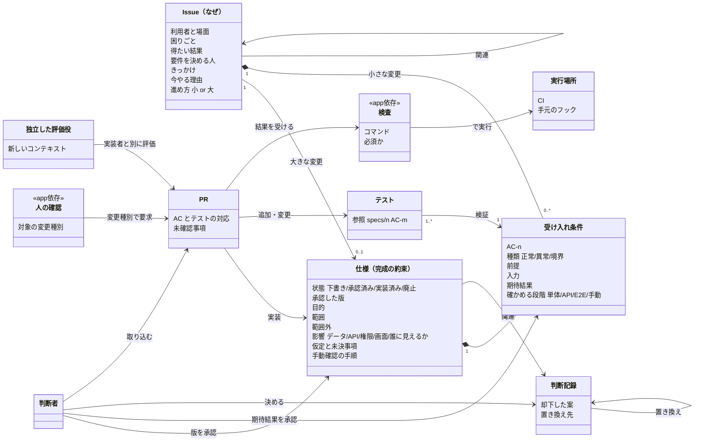
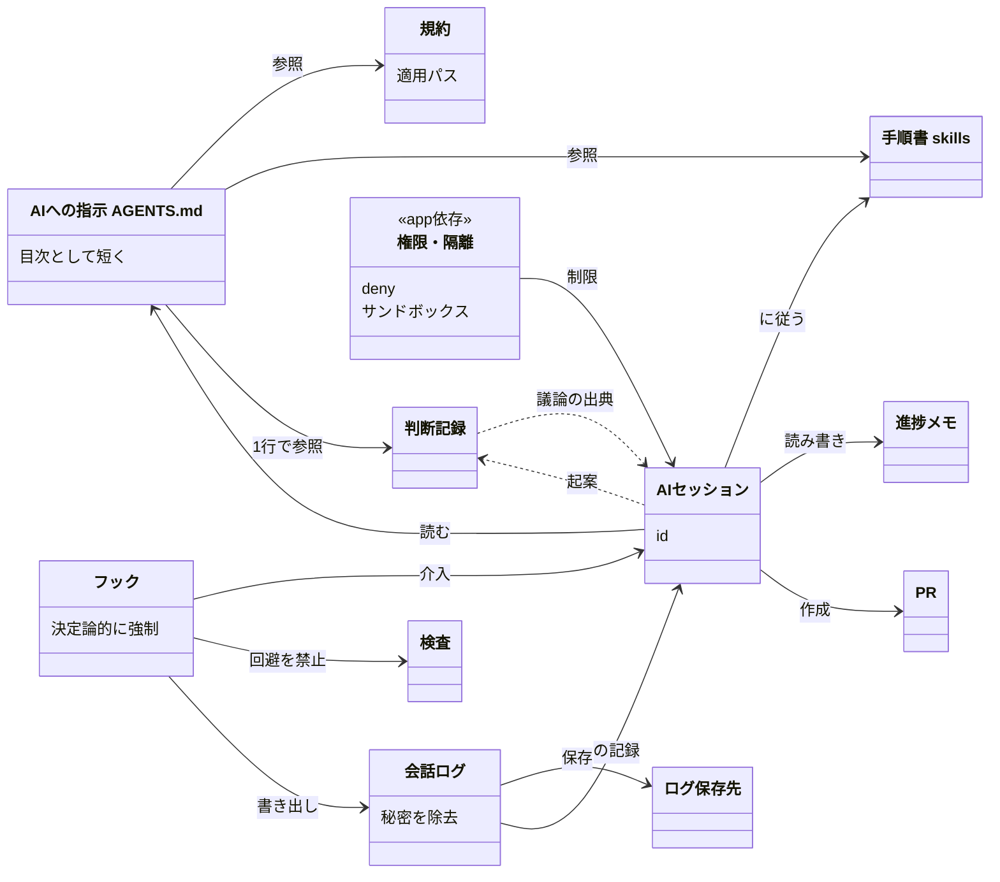
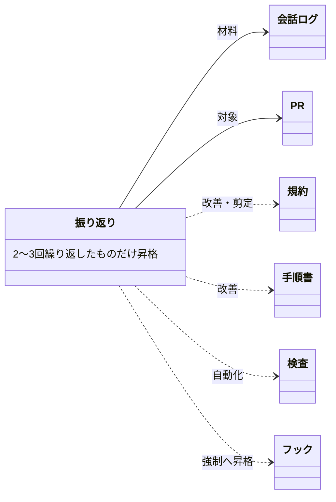

# 開発ハーネスのモデル

状態: 下書き（2026-10-26）
議論: https://claude.ai/code/session_01RRsWb1PMfgKNATkiZKYMQQ
出典: [sources.md](sources.md)　／　表示用: [model.html](model.html)（要素ごとの出典状況、研究から引いた注意、保留した候補を含む）

アプリに依存しない骨格。`<<app依存>>` の中身（どの検査・どの確認・何を禁じるか）は、データモデル・DB・ホスティングが決まってから埋める。

## 1. 作る：仕様から取り込みまで

Issueは「なぜ」、仕様は「何をもって完成か」を持つ。小さな変更は仕様を書かず、IssueにACを直接持たせる。人は仕様を版ごとに承認し、仕様が変わったら承認し直す。ACの期待結果は人が承認し、テストは名前にACのIDを入れて参照する。実装したセッションとは別のコンテキストの評価役がPRを見る。<<app依存>> の中身は、データモデルやDBが決まってから埋める。

## 2. AIを動かす：読むもの・縛るもの・残すもの

指示ファイルは中身を抱えず、規約・手順書・判断記録への目次にする。お願いで済まないこと（検査の回避、テストの書き換え、秘密の読み取り）は、フックと権限で機械的に止める。判断記録はセッションIDで会話ログに戻れる。

## 3. 育てる：振り返りから戻す先

点線は「提案して人が承認したら変える」。1回の失敗ですぐルールにしない。不要になった規約は剪定する。
